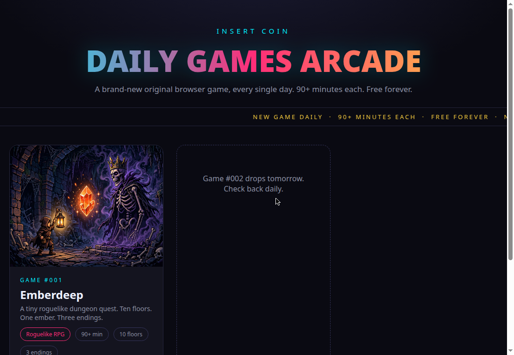

# Daily Games Arcade

A brand-new original browser game, every single day. Each one is a complete game — free forever, no downloads — just open and play.

**Play them all:** https://vivekn4.github.io/daily-games/
**Also on itch.io:** https://trigger-fingerr.itch.io

## Screenshot

## The games

| # | Game | Genre | Play |
|---|------|-------|------|
| 001 | **Emberdeep** — a tiny roguelike dungeon quest. Ten floors. One ember. Three endings. | Roguelike RPG | [Play](emberdeep/index.html) · [itch.io](https://trigger-fingerr.itch.io/emberdeep) |
| ★ | **Shardbound** — a tale of four shards. A complete 8-bit JRPG by Vivek: 47 maps, 3 heroes, 8 bosses. | JRPG | [Play](shardbound/index.html) · [itch.io](https://trigger-fingerr.itch.io/shardbound) |

## How it works

Every morning a new game is designed, built, playtested, and shipped: original story, original sprites, real gameplay screenshots, and a proper release page. Genres rotate daily — RPG, adventure, puzzle, arcade, strategy, horror, and more.

Made with **VN** signature.
