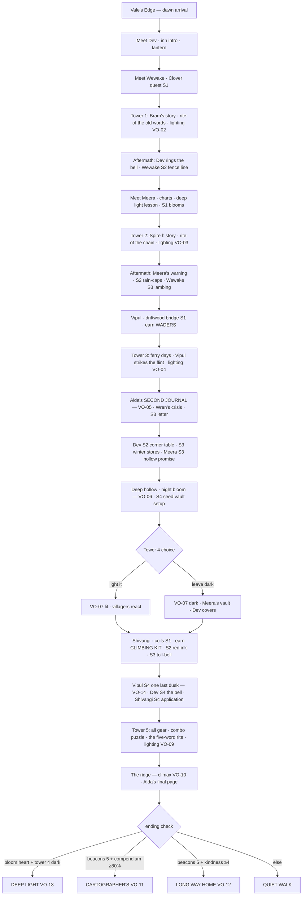

# LANTERNVALE — Story Document
**Writer deliverable — game04-lanternvale, 2026-10-15**

> Convention used below: lines marked **[VO]** are voiceover beats — the
> pre-generated human-sounding narration clips (Meta AI TTS, `audio/vo/`).
> Every **[VO]** line is written as speakable prose: no stage directions,
> no impossible words, commas placed where the voice should breathe.

---

## 1. Premise

You are **Wren**, nineteen, an apprentice mapmaker two seasons into the
trade and still bad at sharpening pencils. Your mentor **Alda** — the best
cartographer the Vale's Edge guild ever trained — walked out last autumn
without finishing her last map. She left behind a brass compass, a field
journal with the middle pages still blank, and one note:

*"Finish the map. Light the towers. Come home by the long way."*

Lantern Vale is a fog-soft river valley cut by a slow river, stitched with
meadows and old groves, hemmed by low cliffs. It used to be marked by five
signal towers whose beacons guided travelers along the long road. One by
one, over four seasons, the towers went dark. The guild says the lamps are
broken and the job is just to relight them and map what's changed.

The guild is wrong about the lamps. Alda dimmed them herself — one per
season — so that whoever came to fix them would have to slow down and meet
everyone she loved here. It was a goodbye gift disguised as a chore.

And the darkness wasn't empty. In the true dark, between the towers, the
valley grows a bioluminescent bloom called the **deep light** — a plant that
dies under lamplight. The last tower stands over the deep hollow, and Wren
has to decide: light it (the map, the job) or leave it dark (the bloom,
Alda's wish). The map, either way, ends up unfinished — on purpose.

No enemies. No clock. Just the walk.

---

## 2. Idea source log

- Idea bank (`~/workspace/tools/idea-feed/idea-feed.py`) run 2026-10-15:
  shortlisted "cozy exploration game" + "map-making as progression".
- r/gameideas scan: quiet-walk threads converged on the same space —
  Big Walk (House House) and Over the Hill (Funselektor) as vibe anchors.
- **Primary inspiration per user directive:** Big Walk / Over the Hill —
  walking, talking, gentle puzzles, dynamic weather, day/night. Vibe only;
  premise, characters, and plot are original.
- OpenGameArt trending: golden-hour palette references for the artist
  (noted in SOUND.md / art brief, no asset reuse from trending packs).

---

## 3. Character sheets

### Wren (player character)
Apprentice mapmaker, 19. Talks to themself while walking (the narration
toggle is mostly Wren's inner voice, written warm, not poetic). Carries
Alda's brass compass — which points the way she *meant* you to go, not
north. Still bad at sharpening pencils. Genuinely fond of goats, which
becomes important.

### Alda
Wren's mentor, late sixties, the guild's best cartographer for forty years.
Off-screen the whole game — she exists in her journal pages, the villagers'
memories, and one final page you'll read on the ridge. She dimmed the five
towers herself — the ridge tower first, before the first frost, then one
per season — as a deliberate slow goodbye. Never
explains herself directly in the journal until the very last page.

### Wewake — the shepherd (Region 1: Vale's Edge meadows)
Fifties, wiry, owns forty sheep and knows each by name and grievance. Lost
a prize ram named **Clover** — the quest is finding him tangled in a bramble
patch up the hill. Talks slowly; every sentence earns its place. Knows Alda
from when she mapped the high pastures thirty years ago.

### Meera — the botanist (Region 2: Mistfall groves)
Thirties, bright-eyed, permanently muddy boots. Studies the deep light and
is the one who explains, reluctantly, that it dies under lamplight. Her
quest: photograph (or collect) three deep-light blooms at night for her
field notes. Keeps naming specimens after people she's annoyed with.

### Vipul — the ferryman (Region 3: the old ford)
Seventies, retired ferry operator. The river rose after the last storm and
washed out his rope ferry; his quest is repairing the footbridge together
(collect driftwood + one puzzle). Keeps Alda's second journal in his hut —
he hid it there because "she told me to, and I was already an old man and
she was Alda."

### Dev — the innkeeper (Region 1: Vale's Edge village / inn)
Forties, runs the Lantern Inn. No-nonsense, enormous laugh. Her quest: the
inn's old recipe book is missing a page (Alda's favorite stew) — find the
torn page in the root cellar, or gather the missing herb. Gives you the
**storm-lantern** gear item after. Warm; feeds you even when you don't ask.

### Shivangi — the bridge-keeper (Region 5: the high rope bridge)
Twenty-four, former apprentice bridgewright who never finished the trade
(you have things in common). Tends the old rope bridge to tower 5; the
quest: find the spare rope coils she dropped in the cliff scrub, then help
re-tension the bridge. Gives you the **climbing kit**. Wry, dry humor, the
only person in the valley who finds the towers' politics funny.

### Gear note
Wren earns gear across the valley: **waders** (from Vipul, after the bridge
repair — ford the river), **climbing kit** (from Shivangi — cliff paths), and
the **storm-lantern** (from Dev — the unlit deep hollow). The journal
always tells you who to ask when you're stuck.

---

## 4. Story spine — the five beats

### Beat 0 — INTRO [VO]
Wren arrives at Vale's Edge at dawn with the unfinished map, the compass,
and Alda's note. Dev is sweeping the inn steps. Wewake passes with the
flock. The first tower is visible on the hill, dark.

### Beat 1 — Towers 1–2 (Wewake, Meera)
Meet Wewake (lost ram quest), light tower 1. Meet Meera, learn about the deep
light [VO tower beats]. First journal hint that the towers "didn't break
all at once" — Meera noticed the outages matched the seasons.

### Beat 2 — Tower 3 (Vipul's hut — the second journal) [VO]
Repair the footbridge with Vipul, light tower 3. In Vipul's hut you find
Alda's **second journal**: she dimmed the towers herself — the ridge tower
first, before the first frost, then one per season — so travelers would
slow down and meet everyone she loved. It was a goodbye gift disguised as
a chore.

### Beat 3 — Tower 4 (the deep hollow — the choice) [VO]
The deep hollow at night, full bloom. Meera explains the bloom dies under
lamplight — that's why Alda kept the towers dark. Wren chooses: light
tower 4 (the map, the job) or leave it dark (the bloom, Alda's wish). The
choice is **reversible and consequence-free** — it feeds the ending, not a
fail state.

### Beat 4 — Tower 5 (Wewake walks with you)
The last tower is across the old rope bridge and needs all three gear
items. Wewake walks with you partway — a quiet walker-talker stretch [VO]:
he talks about Alda as a young mapmaker, and about Clover the ram, who is
fine.

### Beat 5 — CLIMAX (the ridge) [VO]
All five beacons burn. From the ridge, the vale is a string of five lights
— and below them, in the dark between, the deep light answers back.
Alda's final journal page: *"You came home by the long way. Now the map is
yours to leave unfinished."*

---

## 5. Voiceover beats — speakable scripts [VO]

All 12 clips. Written for a soft, feminine storybook voice at an
unhurried pace. Pause marks (— and ...) are rhythm, not decoration.

### VO-01 · intro (the arrival)
> I got into Vale's Edge at dawn, which turned out to be the only way to
> get in — the fog closes behind you like a door. The inn was sweeping its
> steps. A flock of sheep was already ahead of me on the road, which told
> me exactly what kind of place this was. The first tower was up on the
> hill, dark. Alda's note was in my pocket, folded into quarters, and it
> said: finish the map, light the towers, come home by the long way. So I
> went the long way. There wasn't a short one anyway.

### VO-02 · tower 1 lit
> The lamp took on the second strike of the flint, which felt like a small
> blessing. And then — light, all the way down the valley. Wewake looked up
> from his flock and waved like he'd been waiting. It occurred to me that
> this was the first tower anyone had lit in a year, and I was an
> apprentice, and I did it anyway. The compass needle spun once and settled
> south. Alda's brass was never much for north.

### VO-03 · tower 2 lit
> Two towers now. From the grove I could see the first one answering —
> that's the trick of it, Meera said, they were built to be seen from each
> other, like a chain of people keeping each other's lights in sight. She
> showed me the deep light then, a little of it, cupped in her hands,
> glowing blue at the edges. She said it only wakes in true dark. I wrote
> that down, because it felt like the kind of thing you remember later.

### VO-04 · tower 3 lit
> Vipul cried when the third beacon caught. He denied it later, but the
> man stood there with the wind in his face and tears going sideways, and
> you can call it whatever you like. Forty years he'd run that ferry by
> the tower lights. He put his hand on my shoulder — it weighed about a
> stone — and said, "She'd have wanted you to be the one." He never did
> tell me what he meant.

### VO-05 · Alda's second journal (beat 2 reveal)
> Her handwriting again, but rushed, like she'd written it standing up.
> *"If you're reading this, the third tower's lit, which means Vipul finally
> stopped hiding my journal — thank you, Vipul, you stubborn old rock.
> Here's the truth I didn't put in the guild copy: the towers weren't
> broken. I dimmed them myself, one per season, autumn to summer. You'd
> never meet anyone if the road was lit. You'd walk it at speed and call it
> a day and be poorer for it. So slow down, Wren. Meet them all. Light the
> towers last."*

### VO-06 · deep hollow discovery (night)
> I'd seen the bloom in Meera's hands, but that was a cupful. This was a
> meadow of it — blue light breathing up out of the hollow floor, like the
> ground was dreaming. No moon. No lamps. Just the valley keeping its own
> light for itself. I sat down without deciding to. Some places you stand
> in, and some places you sit down in, and I think that tells you the
> difference.

### VO-07 · tower 4 lit (or left dark — text adapts)
> Lit: *I lit the fourth tower. The bloom below folded back into the dark
> like a held breath, and I stood there a long time, feeling like I'd
> chosen wrong with my whole chest. Alda said light the towers. Alda also
> dimmed them for a reason. You can walk away from a lamp, I thought. You
> can come back. Nothing in this valley is finished, and that's the point
> of it.*
>
> Dark: *I left the fourth tower dark. It felt like disobeying her and
> obeying her at the same time, which is a trick only Alda could have
> built. The bloom kept breathing below me, blue and slow. I told myself
> the map would be fine with one dark tower on it. Maps are allowed to be
> honest.*

### VO-08 · Wewake's walker-talker stretch
> Wewake walked with me to the rope bridge and told me about Alda when she
> was young — how she mapped the high pastures and got lost three times
> in one week and named a sheep after the guild master out of spite. He
> didn't say much after that. We just walked. The bridge swayed under our
> boots, and the fifth tower stood up ahead, and I remember thinking: this
> is the walk the note meant. The long way. This one.

### VO-09 · tower 5 lit
> Five lights. The last one took longest — the lamp was gummed up with
> four seasons of dust and my hands were shaking, not from the cold.
> When it caught, the beacon swept the whole valley, cliff to cliff, and
> every window in Vale's Edge lit up in answer. Somebody down there rang
> the inn bell. I laughed, which surprised me. An apprentice did that. An
> apprentice who was still bad at sharpening pencils.

### VO-10 · climax — the ridge
> From the ridge, the vale was a string of five lights — and below them,
> in the dark between, the deep light answered back, blue against the
> gold. It wasn't either-or, like I'd been afraid of. It was both, if you
> stood far enough back. Alda's last page was tucked in the journal's back
> cover, and I read it by beacon light: *"You came home by the long way.
> Now the map is yours to leave unfinished."* I folded it into quarters
> and put it in my pocket, next to hers.

### VO-11 · ending — THE CARTOGRAPHER'S ENDING
> They hung my map in the Lantern Inn, over the fireplace, where the
> travelers can see it. It's wrong in places — I know exactly where — but
> people use it, and write notes in the margins, and every spring somebody
> adds a correction. Alda would have hated that and loved it. That's the
> cartographer's ending, I suppose: the map outlives you, and everyone
> else finishes it the long way.

### VO-12 · ending — THE LONG WAY HOME
> I stayed the winter. It wasn't a decision so much as a series of small
> non-decisions: one more stew at Dev's, one more lambing season with
> Wewake, one more spring with Meera's specimens. The map got finished
> slowly, over tea, one page at a time, and nobody at the guild minded.
> Alda knew, I think. "Come home by the long way," she wrote. She just
> never said where home was.

### VO-13 · ending — THE DEEP LIGHT
> The last tower stays dark. I tell the guild the lamp's cracked beyond
> mending, which is almost true — the truth is I chose the bloom. On a
> clear night you can stand in the hollow and watch the valley breathe
> blue, and my map has a blank spot right there in the middle, drawn with
> a little star. "Unfinished," it says, "on purpose." Every map should
> have one.

---

## 5b. New VO candidates (expansion 2026-10-15 — for the Voice Director)

Same voice (Aria, avocado_v2:MAI_01, speed 105), same human-warm
second-person prose. Generate when the voice director does its next pass;
wire to the beats in MISSIONS.md. ~4 clips, ≈1.5 MB — inside the 8 MB
budget (current 3.18 MB).

### VO-14 · Vipul's dusk (stage 4, tower-3 base at dusk)
> I stood with Vipul under the third tower while dusk settled, and neither
> of us talked for a long time. The beacon turned on above us, gold against
> the blue, and he laughed — wetly, the way old men laugh when they're
> trying not to cry. Forty years he'd watched that light from the water.
> He'd never once stood under it. "Be kinder than the river was to me,"
> he said. I've been trying ever since.

### VO-15 · the hollow promise (Meera, stage 3, at night)
> Meera took me to the mother cluster — the oldest bloom in the hollow —
> and asked me for a promise. Not to choose one way or the other. Just to
> decide it looking at the bloom, not at the map. I promised. It was the
> easiest hard promise I've ever made. The bloom didn't care about my map.
> I think that's why I love it. I think that's why she did, too.

### VO-16 · the star map (quiet moment, ridge at night)
> I lay on the cold stone of the ridge and named the stars after everyone.
> Wewake, low and stubborn. Meera, bright. Vipul, flickering. Dev, warm.
> Shivangi, holding her breath. And Alda — Alda's the dark between them,
> the map you navigate by. I fell asleep for a minute. Nobody minded. The
> valley keeps its own watch.

### VO-17 · the lambing (Wewake, stage 3, after midnight)
> The lamb came just after midnight — grey as dusk, loud as a bell. Wewake
> laughed quietly into his sleeve, and I understood something about him
> all at once: this is what he does. He stays. Through lambings and storms
> and dark towers, he stays. Alda drew his sheep thirty years ago. I held
> the lantern steady and didn't fuss, and the valley gave me its story,
> like he said it would.

---

## 6. Villager questlines (kindness stat, 0–5)

Each villager has a 3–4 stage personal questline (full catalog with
triggers, resolutions, and world-state effects: see **MISSIONS.md**).
**Kindness economy (unchanged):** only each villager's STAGE 1 (their
signature quest) grants Kindness +1 — the 0–5 scale and the Long Way Home
threshold (≥4) are preserved. Later stages grant other rewards: gear,
shortcuts, journal pages, compendium marks, charms, and ending-epilogue
material. Nothing is timed; stages unlock in order as the regions open.

| Villager | S1 (kindness) | S2 | S3 | S4 |
|---|---|---|---|---|
| Wewake (shepherd, R1) | Find Clover the ram → shortcut + trust | The fence line: hold 3 posts → shepherd's whistle (Pip follows) | Lambing night: steady hands → Alda's pasture sketch | The last walk (Beat 4; veteran variant if S2+S3 done) |
| Meera (botanist, R2) | Log 3 blooms at night → bloom sites + lantern glass | Rain-cap census (4, rain/fog) → "Wren's Folly" specimen (→ Dev's stores) | The hollow promise (night) → her support, loudly, in writing | The seed vault (post tower-4) → pressed bloom seeds |
| Vipul (ferryman, R3) | Driftwood bridge repair → **waders** | The second journal → the truth (+ Wren's crisis) | The long letter → walk to Dev (+ ferry bell) | One last dusk at tower 3 → his blessing [VO-14] |
| Dev (innkeeper, R1) | Recipe page → **storm-lantern** + free meals | The corner table: find the wedge → Alda's chair | Winter stores: 5 items → trail food + stew page | The bell: lantern with your name (pre-climax) |
| Shivangi (bridge-keeper, R5) | Rope coils + tensioning → **climbing kit** | The red-ink plans: rebuild her way → her respect | The toll-bell (Pip can find it) → rung at tower 5 | The application: sketch the bridge → she re-apprentices |

**Interweaves:** Vipul's letter is delivered to Dev · Meera's mushrooms go
to Dev's stores · Wewake's whistle lets Pip find Shivangi's toll-bell ·
Dev's stew goes to Wewake's lambing. Helping one villager opens or warms
another's story.

---

## 7. The four endings — trigger conditions

Computed at the ridge scene from: beacons lit × compendium % × kindness ×
deep-light discovery. Priority order if multiple conditions hold:
DEEP LIGHT > CARTOGRAPHER'S > LONG WAY HOME > QUIET WALK.

1. **THE DEEP LIGHT** — discovered the bloom heart at night **and** tower 4
   currently dark (left dark by choice). Wren maps the dark instead.
   (Reward: the quiet, Alda-true ending.)
2. **THE CARTOGRAPHER'S ENDING** — all 5 beacons lit **and** compendium ≥
   80% (≥29/36). Wren's finished map hangs in the Vale's Edge inn;
   travelers use it for years. (Reward: completionist / explorer.)
3. **THE LONG WAY HOME** — all 5 beacons lit **and** kindness ≥ 4. Wren
   stays the winter; the valley keeps her; the map is finished slowly,
   over tea. (Reward: helper / friend of the valley.)
4. **THE QUIET WALK** (fallback — always achievable): the valley keeps a
   smaller memory — a fence post by the east line carved with two sets of
   initials, A. and W.: Alda carved hers decades ago, and Wren adds hers
   beside it, found by the next traveler. This is a *complete, warm*
   ending, not a punishment; the epilogue text says so explicitly.

All four use a title card + narrated epilogue + stats screen (time
walked, seed, compendium %, kindness). No ending is a "bad" ending.
Epilogues are modular: a base text plus conditional inserts that reflect
the player's specific journey (which questlines finished, kindness,
quiet moments found) — see `DIALOGUE.endingEpilogues` and MISSIONS.md §7.

---

## 8. Flowchart

*Note: quest stages unlock in order per villager as regions open; the
chart shows the authored spine. Interweaves: Vipul's letter → Dev ·
Meera's mushrooms → Dev's stores · Wewake's whistle → Pip finds
Shivangi's bell · Dev's stew → Wewake's lambing. Quiet moments (fox,
rain, stars, pencil) and photo challenges float free of the spine.*

---

## 9. Voiceover clip manifest (for the Voice Director)

12 clips → `audio/vo/` (≤ ~8 MB total). Voice: warm, gentle, soft feminine
storybook tone, slow pace (speed ~105–110). **Not** dark/noir, not Chip,
not Oak/Cornerstone — user picks by ear from 3 auditions.

| File | Beat | Approx words |
|------|------|--------------|
| `vo_intro.mp3` | VO-01 intro | ~120 |
| `vo_tower1.mp3` | VO-02 tower 1 | ~100 |
| `vo_tower2.mp3` | VO-03 tower 2 | ~90 |
| `vo_tower3.mp3` | VO-04 tower 3 | ~100 |
| `vo_journal.mp3` | VO-05 second journal | ~110 |
| `vo_hollow.mp3` | VO-06 deep hollow | ~95 |
| `vo_tower4.mp3` | VO-07 tower 4 (both variants = 1 clip each → `vo_tower4_lit.mp3`, `vo_tower4_dark.mp3`) | ~95 each |
| `vo_tamwalk.mp3` | VO-08 Wewake stretch | ~95 |
| `vo_tower5.mp3` | VO-09 tower 5 | ~100 |
| `vo_ridge.mp3` | VO-10 climax | ~110 |
| `vo_end_cartographer.mp3` | VO-11 ending 1 | ~95 |
| `vo_end_longway.mp3` | VO-12 ending 2 | ~105 |
| `vo_end_deeplight.mp3` | VO-13 ending 3 | ~95 |

13 files (VO-07 has two variants). In-game dialogue stays text-only (cozy
reading pace, adjustable text speed). Narration toggle: pre-generated
clips primary, speechSynthesis fallback only.

---

## 10. Human-voice checklist (anti-AI-tell pass)

- [x] No "delve / tapestry / embark / realm / vibrant / nestled" vocabulary
- [x] No "It's not X, it's Y" negative-parallelism constructions
- [x] Concrete specifics everywhere (ram named Clover, brass compass,
      stew recipe page, gummed-up lamp, tears going sideways)
- [x] Humor is dry and human (Wewake's sheep grievances, Meera naming
      specimens after people she's annoyed with, Vipul's denials)
- [x] Characters interrupt themselves, repeat, trail off — like people
- [x] Endings are bittersweet-specific, not grand-vague
- [x] Alda's journal voice is distinct from Wren's narration voice
      (rushed, bossy, affectionate) — two hands wrote this story
